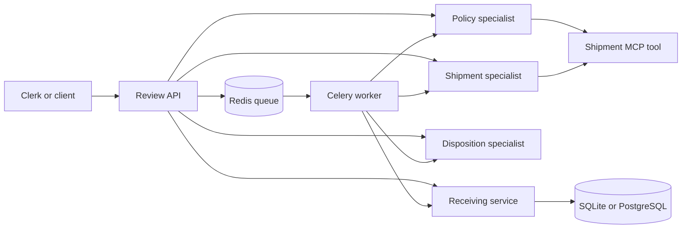

# Holdline

Build and operate a receiving review that keeps a decision tied to its evidence. Holdline checks four synthetic shipments through separate A2A specialist services, reads shipment records through MCP, and records a review in a durable ledger. Python rules choose the disposition. An optional model explains the supplied findings.

This project teaches service contracts, failure handling, retry safety, schema changes, queued work, and deployment. You can complete the first run without Docker, an API key, or a paid service.

## What you will build



A review ends in `READY_FOR_REVIEW`, `BLOCKED`, or `INCOMPLETE`. None releases stock. Human approval and warehouse integration are outside this project; `READY_FOR_REVIEW` is the handoff to a person.

## First run

Use Python **3.14.7** on macOS or Linux. Windows learners should use WSL2 with Ubuntu and follow the Linux commands. Native Windows is not a supported runtime. Download Python from [python.org](https://www.python.org/downloads/) if it is missing. Run these commands from your cloned repository directory:

```bash
python3.14 -m venv .venv
source .venv/bin/activate
python -m pip install -r requirements-dev.lock.txt
python scripts/setup.py
python run.py
```

The setup script creates `.env` with random local credentials. It preserves custom settings, adds missing credentials, and replaces published placeholder values. Open **http://127.0.0.1:8741/** and enter the `HOLD_LINE_TOKEN` value from your own `.env`. The token stays in the tab and travels in an authorization header.

In a second terminal, activate the same environment and run:

```bash
python -m pytest -ra
python -m holdline.live_check
```

The smoke check verifies all four shipments and confirms that retrying each request returns its original ledger record. Stop the application with Ctrl+C. Local data stays in `.run/ledger.sqlite`.

| Shipment | Evidence to notice | Expected result |
| --- | --- | --- |
| HL-2201 | Within 14 days, complete documents, no damage | READY_FOR_REVIEW |
| HL-2202 | Already received | BLOCKED |
| HL-2203 | Held for 40 days | BLOCKED |
| HL-2204 | Hazmat, damage, missing documents | BLOCKED |

## Reproduce the full checks

```bash
ruff check .
ruff format --check .
python -m pytest -ra
python scripts/integration.py
```

The integration check starts its own temporary local services, exercises concurrent retries and dependency failures, then cleans up. Stop `run.py` before running it because it uses the same ports. Logs and database files from this check live in a temporary directory. It never loads your `.env` or calls a model.

## Run the container stack

Docker Engine/Desktop and Docker Compose **2.24.4 or newer** are required.

```bash
python scripts/setup.py
docker compose -f compose.stack.yml up --build -d --wait
```

This starts all six application services, PostgreSQL, Redis, and a Celery worker. Only the API is published, on `127.0.0.1:8741`. The database, queue, and specialists remain on the container network. Use the same browser page and local token.

```bash
docker compose -f compose.stack.yml logs --tail=80 api worker
docker compose -f compose.stack.yml down
```

Named volumes survive `down`. See [operations](docs/operations.md) for backups, restoration, migration, TLS hosting, and cleanup.

## Use queued processing

The container stack enables queued requests. `POST /jobs` returns a review ID and status URL; `GET /jobs/{review_id}` returns durable state and the completed ledger result. Use an `Idempotency-Key` header for every request you may retry. [API examples](docs/api.md) include runnable commands.

For a Python-hosted stack, start the optional dependencies with `docker compose up -d --wait`, configure `DATABASE_URL` and `REDIS_URL` as shown in [operations](docs/operations.md), and run `python run.py --worker`.

## Add model wording

Set `OPENAI_API_KEY` and `OPENAI_MODEL` in `.env`, restart the Python stack, and send `mode: live` through the API. For containers, recreate the services after changing their environment. Live wording can incur provider charges. The browser button always uses rehearsal.

The model receives the validated findings and sources. It cannot change the program's disposition or release state. If wording fails or crosses the release boundary, the review uses its evidence-based fallback and records `explanation_source: fallback`. Model prose still requires human judgment. Application code calls LangChain; its integration uses the provider SDK internally.

LangSmith tracing is optional. Enable `LANGSMITH_TRACING=true` and set its key only for that lesson. Read [the explanation evaluation guide](docs/evaluations.md) before sharing live outputs.

## Learn and contribute

Start with [the learner guide](docs/learner-guide.md). Read [the design note](docs/holdline.md) for the service boundaries and [the operations guide](docs/operations.md) to run them. The design note is also available as [PDF](docs/holdline.pdf) and [Word](docs/holdline.docx).

A complete [AWS CloudFormation deployment](aws/README.md) is provided for an existing VPC. It is optional and creates billable resources. Its template is statically validated; cloud deployment requires your own account acceptance checks. The locally verified deployment is Docker Compose.

Contribution and reuse information: [contributing](CONTRIBUTING.md), [security](SECURITY.md), [community conduct](CODE_OF_CONDUCT.md), and [MIT license](LICENSE).
